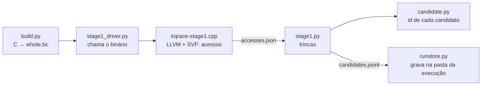

# Código do Stage 1 — Gerar Candidatos

O stage 1 lê o programa compilado e lista **todos** os candidatos a defeito: trincas de acessos à
mesma variável, com A₁ e A₂ num fluxo e B em outro ([[Triples Only]]). Ele **não descarta nada**. Ele ignora
máscaras, prioridades e condições de propósito, para não perder nenhum defeito.

Próximos estágios: [[Código do Stage 2 — Prioridade e Máscara]],
[[Código do Stage 3 — O Solver Z3]].

## Os arquivos e a ordem em que executam



| Arquivo | Linguagem | Papel |
| --- | --- | --- |
| `src/irqrace/build.py` | Python | Compila o C para bitcode LLVM |
| `src/irqrace/stage1_driver.py` | Python | Chama o binário C++ e grava o resultado |
| `analysis/src/irqrace-stage1.cpp` | C++ | Lê o bitcode, usa o SVF, lista os acessos |
| `src/irqrace/stage1.py` | Python | Monta as trincas |
| `src/irqrace/candidate.py` | Python | Dá a cada candidato um id estável |

---

## `build.py` — do C ao bitcode

**O que faz.** Compila cada arquivo C com o Clang para bitcode e junta tudo num arquivo só,
`build/whole.bc`.

**Pontos importantes**

- Ele junta **bitcode**, nunca código C. Juntar código C destrói os números de linha e causa
  conflito entre variáveis `static` de arquivos diferentes.
- Ele **recusa** compilar sem `-g`. Sem `-g`, o bitcode não tem as linhas do C, e nenhuma resposta
  aponta para uma linha.
- Ele grava cada comando em `build/build.log`.

```python
        _run([cc, *flags, "-emit-llvm", "-c", str(src), "-o", str(obj)], log)
...
        _run([linker, *[str(o) for o in objects], "-o", str(whole)], log)
```

**Sai:** `build/whole.bc` (o programa inteiro) e `build/build.log`.

---

## `irqrace-stage1.cpp` — o coração do stage 1

**O que faz.** Carrega o bitcode, executa o SVF e imprime um JSON com: os objetos compartilhados,
cada acesso a eles, a relação "este acesso pode vir antes daquele" e um mapa simplificado do código
para o stage 2.

O `main` do arquivo tem seis etapas, cada uma marcada com um comentário `// ----`.

### 1. Construir o grafo de chamadas (classe `CallGraph`)

Para cada função, lista quem ela chama. Dois cuidados:

- Uma chamada por `bitcast` é uma chamada **direta**. Sem isso, todos os 31 casos pareciam usar  ponteiros de função.
- Uma chamada por ponteiro que o SVF não resolve **nunca** é lida como "não chama nada". A
  ferramenta supõe que ela pode chamar qualquer função compatível.

```cpp
      if (targets.empty() && cfg.signatureFallback) {
        // The recall-critical rule: an unresolved target set is NEVER read as
        // "calls nothing". Resolving to nothing silently deletes whole subtrees
        // of reachable accesses, and the loss is invisible in the output
```

### 2. Alcançabilidade por fluxo (`reachableFrom`)

Parte da função de entrada de cada fluxo (o `main` e cada ISR) e segue as chamadas. Guarda, para
cada função alcançada, um caminho de chamadas desde a entrada. As primitivas de máscara e as
funções externas modeladas não são percorridas.

### 3. Enumerar os acessos

Para cada `load` (leitura) e `store` (escrita) das funções alcançadas, pergunta ao SVF quais
objetos o ponteiro pode tocar:

```cpp
    for (NodeID o : pta->getPts(pag->getValueNode(sv))) {
      if (pag->isBlkObjOrConstantObj(o))
        continue;
      // Normalise to the BASE object. ...
      out.insert(pag->getBaseObjVar(o));
    }
```

Cada acesso grava: fluxo, leitura ou escrita, função, linha do C, se está num laço e o caminho de
chamadas.

### 4. Manter só os objetos compartilhados

Um objeto é compartilhado quando **dois fluxos** o tocam. Não importa se ele é global ou local. O
caso 9 compartilha uma variável local por ponteiros globais; a primeira versão filtrava só globais
e perdia esse defeito.

### 5. A relação `may_precede`

Para dois acessos no mesmo fluxo, diz se o primeiro **pode** executar antes do segundo. O cálculo
usa o grafo de fluxo de controle (CFG). Duas regras importantes:

- Uma instrução num laço pode preceder **a si mesma**. É o caso "mesma linha como A₁ e A₂".
- Uma função chamada duas vezes (dois ou mais pontos de chamada) também faz uma instrução preceder
  a si mesma:

```cpp
  auto multiInvocation = [&](const std::string &flow, const llvm::Function *fn) {
  ...
    if (sit->second.size() >= 2)
      return true;
```

### 6. O mapa do código para o stage 2 (`program`)

Para cada função, grava os blocos, os sucessores e os **eventos** de cada bloco: acessos,
chamadas, primitivas de máscara. O stage 2 não lê o bitcode; ele lê este mapa. Inclui também as
funções que o stage 1 ignora para acessos, como `init`, porque `init` chama `enable_isr(-1)`.

**Sai:** um JSON na saída padrão, que o driver grava em `stage1/accesses.json`.

---

## `stage1_driver.py` — a ponte entre Python e C++

**O que faz.** Monta a linha de comando do binário a partir da configuração, executa e grava o
resultado.

```python
    for f in cfg.flows:
        cmd += ["--flow", f"{f.id}:{f.kind}:{f.entry}:"
                          f"{-1 if f.irq is None else f.irq}:{f.priority}"]
    for p in cfg.masking_primitives:
        cmd += ["--primitive", p.function]
```

**Ponto importante.** Ele marca o stage 1 no manifesto com `dropped_with_proof=0`. O stage 1 é o
gerador: ele nunca descarta.

---

## `stage1.py` — montar as trincas

**O que faz.** Lê `accesses.json` e transforma os acessos em candidatos no formato do contrato C2
(um registro JSON por candidato).

**Pontos importantes**

- **Trincas:** A₁ e A₂ no mesmo fluxo, com A₁ podendo preceder A₂, e B em outro fluxo. Só as
  quatro formas que podem dar resultado errado ficam:

```python
UNSERIALIZABLE = {
    ("read", "write", "read"),
    ("read", "write", "write"),
    ("write", "write", "read"),
    ("write", "read", "write"),
}
```

Este é o único filtro do stage 1. Ele está declarado na lista de suposições (H1b).

- Cada registro leva o código das funções envolvidas e uma seção de **proveniência**: de onde vem
  cada informação (da configuração, de uma prova, de uma aproximação).

**Sai:** `stage1/candidates.jsonl`, um candidato por linha.

---

## `candidate.py` — a identidade de cada candidato

**O que faz.** Calcula um *fingerprint* (um hash SHA-256) de cada candidato. O id é `c` mais os
primeiros 16 dígitos do hash.

**Ponto importante.** O hash usa só **o que o candidato é**: o caso, a classe, a variável e as
linhas dos acessos. Ele não usa a data nem o resultado dos estágios seguintes. Por isso o mesmo
candidato tem o mesmo id no stage 1, no stage 2, no stage 3 e na Trilha B. A Trilha B usa este id
como chave do cache das respostas do LLM.

---

## O resultado do stage 1

| Medida | Valor (31 casos) |
| --- | --- |
| Candidatos | 316 |
| Recall gate | 48/48 |
| Armadilhas presentes | 35/38 (normal: o stage 1 não filtra) |

```bash
irqrace stage1 bench/configs/svp_simple_001_001.yaml
```
