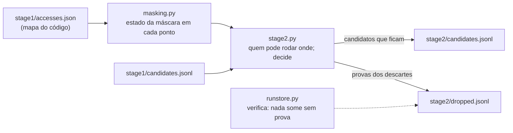

# Código do Stage 2 — Prioridade e Máscara

O stage 2 pergunta, para cada candidato: **o fluxo de B pode mesmo executar naquele ponto?** Ele
usa a prioridade e a máscara de interrupções. Ele descarta um candidato só com prova, e grava a
prova.

Estágio anterior: [[Código do Stage 1 — Gerar Candidatos]]. Próximo:
[[Código do Stage 3 — O Solver Z3]].

## Os arquivos



| Arquivo | Linguagem | Papel |
| --- | --- | --- |
| `src/irqrace/masking.py` | Python | Calcula quais interrupções podem estar ligadas em cada ponto de cada fluxo |
| `src/irqrace/stage2.py` | Python | Decide se cada candidato fica ou sai, e escreve a prova |
| `src/irqrace/runstore.py` | Python | Grava os arquivos e verifica a regra "nada some sem prova" |

O stage 2 não chama nenhum programa externo. Ele lê só os arquivos do stage 1.

---

## `masking.py` — o estado da máscara

**O que faz.** Para cada fluxo e cada ponto do programa, calcula o conjunto de valores que cada
interrupção pode ter: `D` (desligada), `E` (ligada) ou `U` (desconhecida, tratada como ligada).

### Ponto 1 — "desligada" só em todos os caminhos

Uma interrupção conta como desligada **só se todos os caminhos** até o ponto a desligam. Se um
caminho a deixa ligada, ela pode estar ligada.

```python
def masked(cell) -> bool:
    """Masked on every path: the only reading of "masked" this project uses."""
    return bool(cell) and all(v == D for v, _ in cell)
```

### Ponto 2 — cada valor guarda a sua origem

Cada valor sabe de onde veio: o `disable_isr(2)` da linha 28, o `enable_isr(2)` da linha 46 da
ISR 1, o estado inicial. Com isso, o stage 2 escreve frases que explicam cada decisão.

### Ponto 3 — a interferência

A máscara é **um registrador só**, para todos os fluxos. Se a ISR 1 pode executar num ponto do
`main`, o que ela deixa na máscara também vale para o `main` depois:

```python
    def _close(self, flow: str, fn: str, s):
        """Apply, to a closure, everything a flow firing here may leave behind."""
        ...
            for G in self.direct(flow, c):
                grown = join(grown, self.effect.get(G.id))
```

Este é o ponto que salva o bug point do caso 1. O `main` desliga a interrupção 2, mas a ISR 1 pode
ligar de novo no meio.

### Ponto 4 — onde uma ISR começa

Uma ISR começa no estado de **qualquer** ponto onde ela pode disparar, em qualquer fluxo. Ela pode
disparar antes do primeiro `disable_isr` do `main`, por exemplo.

```python
                        # F8: an ISR starts in the state of any point it may fire at.
                        for G in self.direct(F.id, c):
                            isr_entry[G.id] = join(isr_entry[G.id], c)
```

### Ponto 5 — o cálculo só termina convergido

O estado da ISR depende do `main`, e o do `main` depende da ISR. O cálculo repete até nada mudar
(um *ponto fixo*). Se não convergir no limite de rodadas, ele dá **erro**. Ele nunca usa um
resultado pela metade, porque um resultado pela metade não é seguro.

---

## `stage2.py` — a decisão

**O que faz.** Para cada candidato, calcula quais fluxos podem rodar onde ele precisa e decide se
ele fica.

### As três classes

| Classe | Papel |
| --- | --- |
| `Concurrency` | "Quem pode rodar enquanto o fluxo F está no ponto p?" Inclui ISRs aninhadas |
| `FlowGraph` | Liga os CFGs das funções de um fluxo; calcula o **intervalo** entre A₁ e A₂ |
| `Stage2` | Decide cada candidato, escreve o registro novo ou a prova do descarte |

### A regra: a propriedade de intervalo

- **Trinca (A₁, B, A₂):** fica se o fluxo de B pode rodar em **algum ponto** de **algum caminho**
  entre A₁ e A₂, incluindo as funções chamadas no caminho. O estado em A₁ e em A₂ é só evidência:
  mascarada nos dois acessos não quer dizer mascarada entre eles.

```python
    def interval(self, after_a1: tuple, before_a2: tuple) -> frozenset:
        """Every point on some path from just after A1 to just before A2."""
        ...
        return self._fwd[after_a1] & self._bwd[before_a2]
```

O intervalo é tudo que vem depois de A₁ **e** chega a A₂.

### Os três motivos de descarte

| Motivo | Significa | Exemplo |
| --- | --- | --- |
| `priority` | o fluxo de B nunca roda enquanto o de A₁ está ativo | B no `main`, A₁ e A₂ numa ISR: o `main` nunca interrompe uma ISR |
| `masking` | a interrupção de B fica desligada em todo o intervalo, e nada que roda ali a liga | uma seção crítica que cobre A₁ e A₂ inteiros |
| `no-path` | não existe caminho de A₁ até A₂ | A₁ na última linha do `main` |

### Uma ISR aninhada começa onde disparou

Uma ISR que dispara **dentro** do intervalo começou dentro dele. O que pode rodar dentro dela é
calculado a partir do estado do ponto onde ela disparou, e não de todos os estados possíveis. Esta
regra rejeitou três armadilhas a mais (casos 027, 028 e 030).

### Cada descarte vira uma prova

```python
        return {
            "candidate_id": rec["id"],
            ...
            "reason": v.reason,
            "proof": v.proof,
            "relies_on": v.relies_on,
        }
```

`relies_on` lista as suposições da prova (por exemplo `E1`, `F2`). Se uma suposição mudar um dia,
basta procurar o código dela nos arquivos de prova.

### O que muda nos candidatos que ficam

O registro ganha a prioridade (`preemption`), o estado da máscara em cada acesso e no intervalo
(`masking`) e uma frase de explicação. Exemplo real, o bug point do caso 1:

```
isr_2 may run within [line 32, line 35] of main ... main masks it itself
(disable_isr(2) at line 28), but isr_1 may run inside the interval and unmask it
```

O id do candidato **não muda**.

---

## `runstore.py` — a regra "nada some sem prova"

**O que faz** (na parte do stage 2). Grava `stage2/dropped.jsonl` e verifica cada execução:

```python
            for cid in sorted(s1 - s2 - dropped):
                problems.append(
                    f"candidate {cid} is in stage1 but neither in stage2 nor in "
                    "stage2/dropped.jsonl: it vanished without a proof, which is a "
                    "silent recall loss (C3 rule 6)")
```

Todo candidato do stage 1 tem de estar no stage 2 **ou** ter uma prova. O comando
`irqrace runstore check` executa esta verificação.

---

## O resultado do stage 2

| Medida | Valor (31 casos) |
| --- | --- |
| Candidatos | 316 → 202 |
| Descartes, todos com prova | 114 (priority 45, masking 7, no-path 62) |
| Recall gate | 48/48 |
| Armadilhas rejeitadas | 5 |

```bash
irqrace stage2 bench/configs/svp_simple_001_001.yaml -v
```

O `-v` mostra cada descarte com a sua prova.
