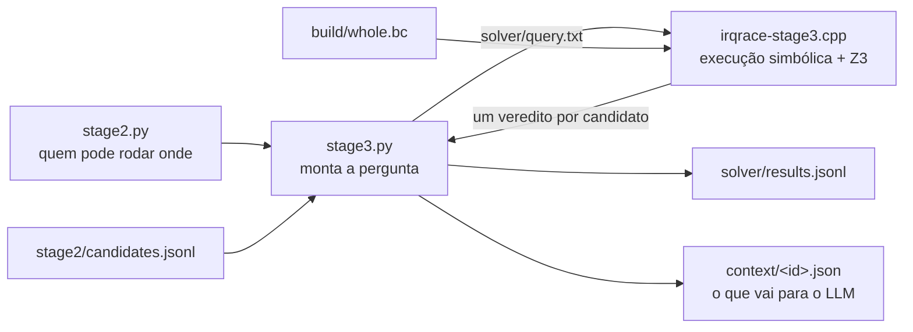

# Código do Stage 3 — O Solver Z3

O stage 3 pergunta: **existe uma execução em que A₁ acontece, depois B, depois A₂, todos na mesma
posição de memória?** Ele "executa" o programa com símbolos e pergunta ao solver Z3. Se o Z3
responde `unsat` (não existe), o candidato sai. É o único estágio cujo veredito descarta por prova
matemática.

Estágios anteriores: [[Código do Stage 1 — Gerar Candidatos]],
[[Código do Stage 2 — Prioridade e Máscara]].

## Os arquivos



| Arquivo | Linguagem | Papel |
| --- | --- | --- |
| `src/irqrace/stage3.py` | Python | Monta a pergunta, chama o binário, grava os vereditos e os registros para o LLM |
| `analysis/src/irqrace-stage3.cpp` | C++ | Executa o programa de forma simbólica e pergunta ao Z3 |

O C++ é necessário porque o Z3 desta máquina só existe como biblioteca C++, e porque o código
precisa ler o LLVM e o SVF.

---

## `stage3.py` — a pergunta e as respostas

### Ponto 1 — levar o stage 2 até o solver

O solver precisa saber quem pode rodar em cada ponto. O Python já sabe isso (stage 2). Ele não
recalcula: ele escreve num arquivo, para cada trecho de instruções, quais fluxos podem rodar ali.

```python
                    run = c.run(F.id, m.state(F.id, (fn, b, k)))
                    out.append(f"run {F.id} {fn} {b} {lo} {hi} {','.join(sorted(run)) or '-'}")
```

Cada linha quer dizer: "no fluxo F, na função fn, bloco b, entre as instruções lo e hi, estes
fluxos podem rodar". O arquivo completo fica em `solver/query.txt`.

### Ponto 2 — o que cada veredito significa

| Veredito | Significa | O que acontece |
| --- | --- | --- |
| `unsat` | não existe execução possível: é uma **prova** | o candidato sai |
| `sat` | a ferramenta **não conseguiu refutar**. Não é confirmação | o candidato vai para o LLM |
| `inconclusive` | o tempo acabou ou o código é complexo demais | o candidato vai para o LLM |

### Ponto 3 — o registro para o LLM

Para cada candidato `sat` ou `inconclusive`, grava `context/<id>.json`: o registro do stage 2 mais a resposta do solver e uma frase de explicação. Este é o arquivo que a Trilha B lê.

---

## `irqrace-stage3.cpp` — a execução simbólica

O arquivo tem três partes: ler a pergunta (`readQuery`), os fatos fixos do programa (`Facts`) e o
executor (`Executor`).

### Parte 1 — `Facts`: o que vale para o programa todo

- Para cada global e cada variável local, o objeto do SVF correspondente.
- Para cada ponteiro, os objetos para onde ele pode apontar (SVF).
- Para cada fluxo e cada laço, o que ele **pode escrever**. Um detalhe importante:

```cpp
    // A load writes no program object -- not even a volatile one, which LLVM's
    // mayWriteToMemory() counts as a write because the hardware may react to
    // it.
    if (llvm::isa<llvm::LoadInst>(I)) return ws;
```

Sem esta linha, toda ISR do Racebench "escrevia tudo", e o solver não provava nada.

### Parte 2 — a memória e os ponteiros

Cada objeto é um array de bytes no Z3. Um ponteiro guarda o objeto nos bits altos e a posição nos
bits baixos:

```cpp
  z3::expr ptrOf(NodeID obj, uint64_t off = 0) {
    return C.bv_val((static_cast<uint64_t>(obj) << 40) | off, 64);
  }
```

No fim, a pergunta exige que os três acessos se cruzem na memória (função `overlap`). É isto que
separa `a[1000]` de `a[9999]`, que o stage 1 trata como "o mesmo array".

### Parte 3 — sempre supor o pior caso

Quando o executor não sabe um valor, ele usa um símbolo novo, sem restrição (*havoc*). Três lugares:

| Onde | O que o executor faz |
| --- | --- |
| Na cabeça de um laço | esquece tudo que o laço pode escrever. Uma passada pelo corpo vale por qualquer número de iterações |
| Num ponto onde outra ISR pode rodar | esquece tudo que aquela ISR pode escrever |
| No início de uma ISR | a memória não tem restrição, porque a ISR pode disparar em qualquer momento |

Por isso `unsat` é prova: o executor nunca sabe mais do que o programa real permite.

### Parte 4 — a busca

Cada estado da busca tem uma **fase**:

```cpp
enum class Phase {
  SeekA1,     // the preempted flow, before A1
  SeekSplice, // the preempted flow, after A1, before the preemption
  SeekB,      // the preempting flow, from its entry, looking for B
  SeekA2,     // the preempted flow resumed, looking for A2
  ...
```

1. Executa o fluxo de A₁ desde a entrada até A₁.
2. Depois de A₁, em cada ponto onde o fluxo de B pode rodar, cria um ramo: "B interrompe aqui".
3. No ramo, executa o fluxo de B desde a entrada até B (o *splice* do IntRace).
4. Volta ao fluxo de A₁ e procura A₂.
5. Em A₂, pergunta ao Z3 se as condições de caminho e o cruzamento dos endereços têm solução.

Em cada `if`, o executor segue os dois lados e guarda a condição. O Z3 corta os caminhos
impossíveis.

### Parte 5 — a projeção de endereços (o atalho)

Antes da busca completa, o executor explora cada acesso **sozinho** e pergunta: "os três endereços
podem coincidir?". Esta pergunta é mais fraca que a original. Se ela já não tem solução, a
original também não tem. Ela resolve 36 dos 53 `unsat` em milissegundos.

### Parte 6 — o que vira `inconclusive`

Recursão, laço sem cabeça natural, timeout (10 s por candidato), orçamento de estados esgotado. Nada
disso vira `sat` nem descarte.

---

## Os três bugs que os testes guardam

| Bug | Efeito | Teste |
| --- | --- | --- |
| Uma decisão antes de A₂ escondia A₂ | `unsat` falso numa armadilha alcançável | `test_a_preemption_just_before_a2_does_not_hide_a2` |
| Leitura `volatile` contada como escrita | quase nenhuma prova saía | `test_a_volatile_read_is_not_a_write` |
| Aresta de volta cruzada uma vez no total | `unsat` falso numa violação real | `test_the_back_edge_is_crossed_once_per_phase` |

Os três testes estão em `tests/test_stage3.py`. Cada um falha se o bug voltar.

---

## O resultado do stage 3

| Medida | Valor (31 casos) |
| --- | --- |
| Candidatos | 202 → 166 chegam ao LLM |
| `unsat` (descartes com prova) | 36 (27 pela projeção, 9 pela busca) |
| `inconclusive` | 0 |
| Recall gate | 48/48 |
| Armadilhas refutadas | 14 |
| Tempo | 17,6 s nos 31 casos |

```bash
irqrace stage3 bench/configs/svp_simple_001_001.yaml -v
```
